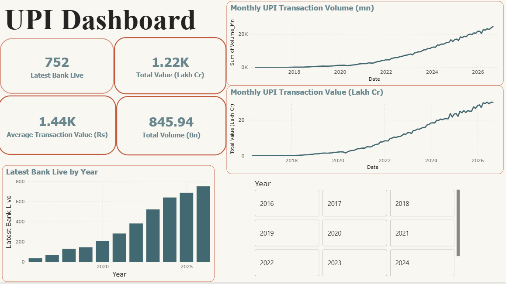
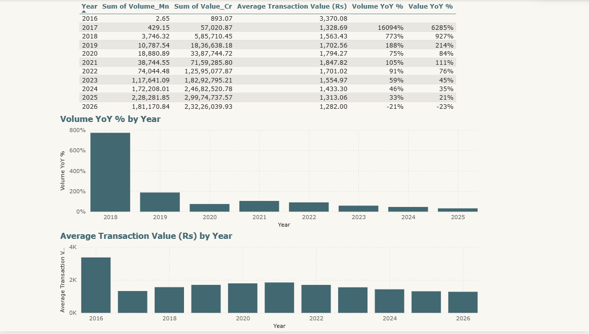

# UPI Transactions Dashboard (Power BI)

A two-page Power BI dashboard analysing the growth of India's UPI payments from April 2016 to August 2026: transaction volume, value, average transaction size and bank participation.

## Business Questions
- How fast have UPI transaction volume and value grown each year?
- Has the average transaction size changed over time?
- How has the number of banks live on UPI grown?

## Dataset
UPI Product Statistics published by the National Payments Corporation of India (NPCI), accessed through the India Data Portal. It has one row per month (125 months) with the number of banks live, transaction volume in millions and transaction value in crores of rupees. Downloaded on 12 October 2026.

## Tools Used
Power BI (Power Query, DAX)

## Key Metrics
| Total Volume | Total Value | Avg Transaction Value | Banks Live (Aug 2026) |
|---|---|---|---|
| 845.94 Bn | 1.22K Lakh Cr | Rs 1,440 | 752 |

## Dashboard Pages
1. **UPI Dashboard:** KPI cards, monthly volume and value trends, banks live by year, and a year slicer.
2. **Growth and Trends:** a yearly summary table (volume, value, average transaction value, year-on-year growth), a year-on-year volume growth chart, and an average transaction value chart.

## Key Insights
1. Volume reached about 228 Bn transactions in 2025, up from about 172 Bn in 2024 (+33%). Value rose from about 24.7 to 30.0 lakh crore (+21%).
2. Growth is slowing as UPI matures. Year-on-year volume growth fell from 105% in 2021 and 91% in 2022 to 33% in 2025, and value growth fell from 111% in 2021 to 21% in 2025.
3. The average transaction value peaked at about Rs 1,848 in 2021 and fell to about Rs 1,313 in 2025, which suggests more frequent, smaller payments.
4. Banks live on UPI grew from 21 in 2016 to 752 in August 2026.
5. August 2026 was a record month, with about 24.5 Bn transactions.

## Notes
- 2026 covers only January to August, so its totals and growth rates are not comparable with full years.
- Growth rates for 2017 and 2018 are very large because UPI had only just launched. The volume growth chart shows 2018 to 2025.

## Dashboard Preview

## Repository Contents
- `upi_dashboard.pbix`: the Power BI file
- the NPCI UPI monthly statistics data file
- dashboard screenshots
